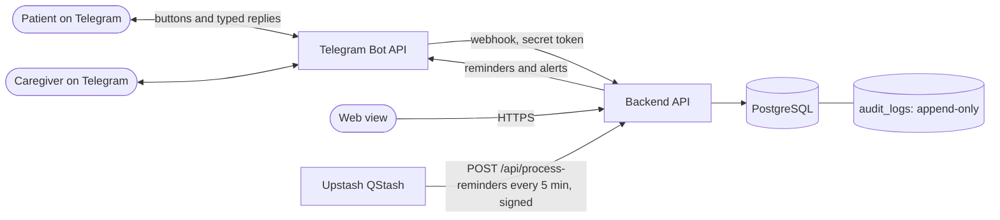

# MediAlert

A medication adherence system for elderly users. Reminders and one-tap dose confirmation run through a Telegram bot, a web view shows today's doses and the caregiver dashboard, and an append-only audit log records every change to a schedule.

MediAlert is a reminder tool. It is not medical advice and does not replace a doctor or pharmacist.

## Status

Day 1 of the MediWeek plan (`mediweek-plan-v4-telegram.md`) is complete: schema and migrations, append-only audit log, least-privilege app role, health endpoint, lint, format, and CI. The Telegram bot token still needs to be created in @BotFather.

## Layout

```
medialert/
  backend/     Node.js + TypeScript API, Telegram webhook, scheduler endpoint
  frontend/    React + Vite web view for patients and caregivers
  docs/        API notes, architecture diagram, evaluation results
```

## Architecture



The backend writes to PostgreSQL through the `medialert_app` role, which can only INSERT and SELECT on `audit_logs`. Scheduling runs outside the server, so free hosts that sleep do not miss reminders.

## Stack

Backend: Node.js, TypeScript, PostgreSQL (Neon or Supabase free tier).
Frontend: React, Vite.
Channel: Telegram Bot API (free, no DLT registration needed).
Scheduling: Upstash QStash calls `POST /api/process-reminders` every 5 minutes.
Prescription reading: local open-source vision model via Ollama in production; a free vision API only for development with synthetic prescriptions.

## Getting started

Requires Node.js 20 or later and PostgreSQL.

```bash
cp backend/.env.example backend/.env   # fill in values; never commit .env
npm install
npm run dev
```

Checks: `npm run format:check`, `npm run lint`, `npm run build`, and `npm test`. The database tests skip when `DATABASE_URL` is not set.

## Environment

Secrets live in environment variables only. See `backend/.env.example` for the full list. Never log message text, medicine names, or chat IDs.

## Privacy

Telegram delivers messages, and bot chats are not end-to-end encrypted. The consent step in the bot says so. Account deletion and data export are planned for Day 6.
